<div align="center">

# 🏃 Decathlon Mobile Clone + RAG Shopping Assistant

**A pixel-faithful mobile sports store, with an AI shopping assistant that actually knows the catalogue.**

Browse 32 real products, filter and sort, compare gear, add to cart, and ask the assistant things like
*"lightest trekking backpack"*, *"compare Kipride Max vs Kipcore Premium"* or *"thick yoga mat for knees"*,
and get grounded, clean answers with product cards you can tap.


-d97757?logo=anthropic&logoColor=white)


<br/>

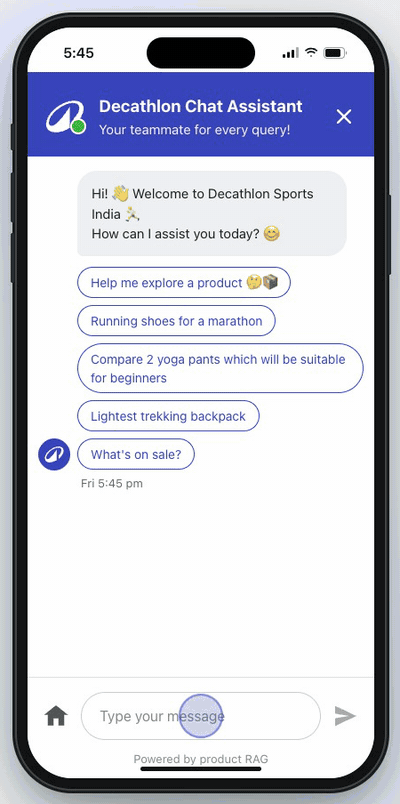
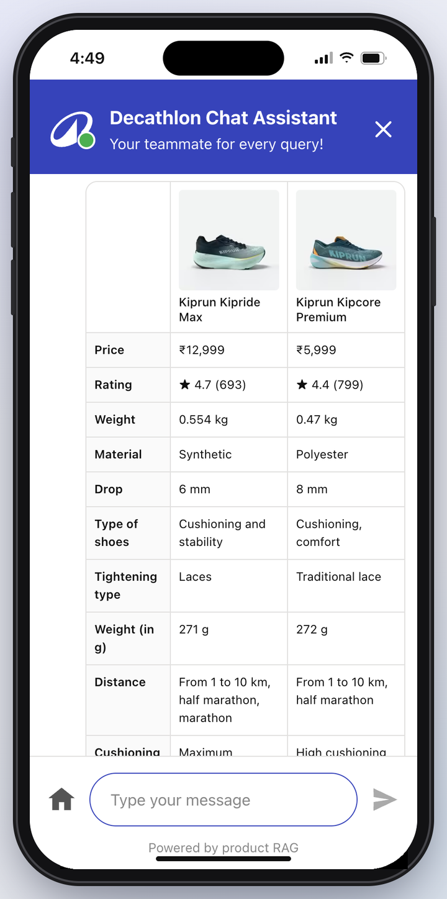
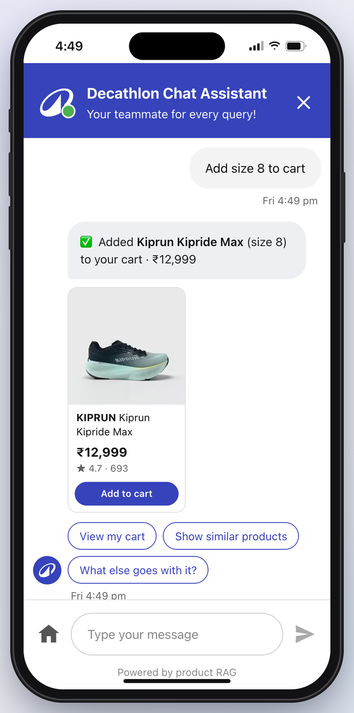

**🎬 [Watch the 1-minute demo video (MP4, 1080p)](docs/demo/decathlon-clone-demo.mp4)**

</div>

---

## ✨ Highlights

- 📱 **Looks like a real phone app**: on a laptop it runs inside an iPhone frame (Dynamic Island, live clock, home bar); on a real phone it's full-screen.
- 🛍️ **Complete shopping flow**: home, categories, search, filters & sort, rich product pages, wishlist, cart with coupons, notifications.
- 🤖 **RAG shopping assistant**: retrieves facts from the catalogue (BM25 over product chunks), understands intent, then writes the answer, offline or with **Gemini** / **Claude**.
- 🧠 **Understands real shopper language**: budgets ("under 2k", "1000 se kam"), who it's for ("for my wife"), needs ("good cushioning", "for knees"), follow-ups ("the second one"), typos ("shose").
- 🛒 **Takes actions**: "add it to cart" asks for your size, then adds it to the real cart.
- ✅ **Honest by design**: answers only from catalogue facts, says when something isn't stocked, and keeps working if the AI is down.

---

## 📸 Screenshots

### Store

| Home | Category | Product page | Search |
|:---:|:---:|:---:|:---:|
| 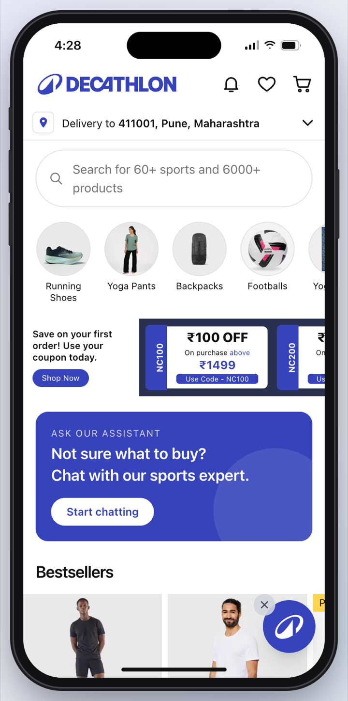 | 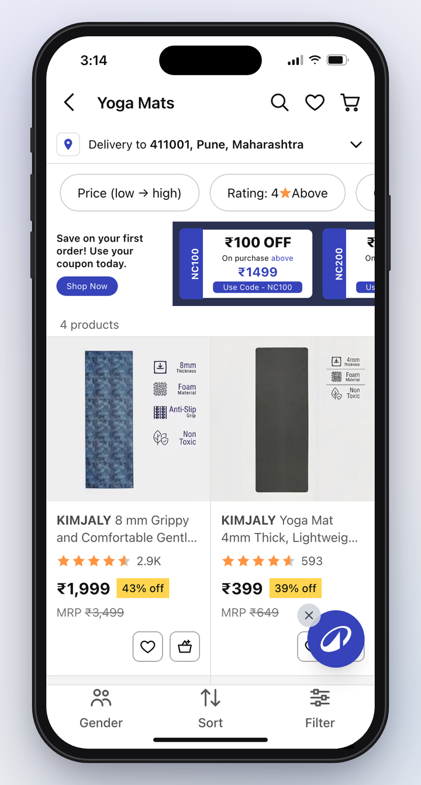 | 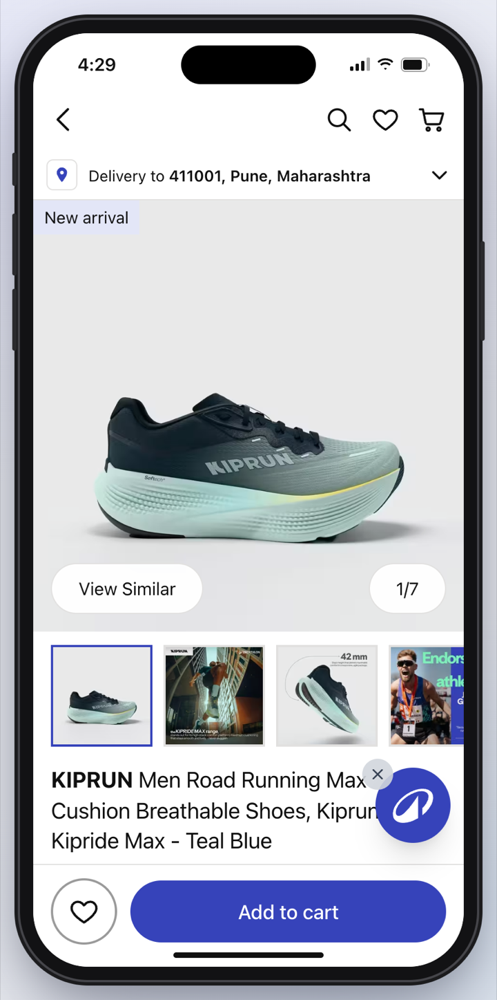 | 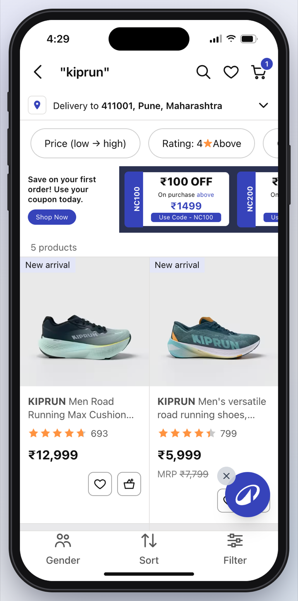 |

### AI shopping assistant: ask → compare → add to cart

| 1. "Running shoes for a marathon" | 2. "Compare the top 2" | 3. The full comparison table |
|:---:|:---:|:---:|
| 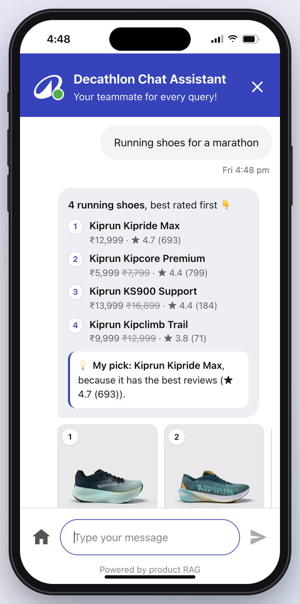 | 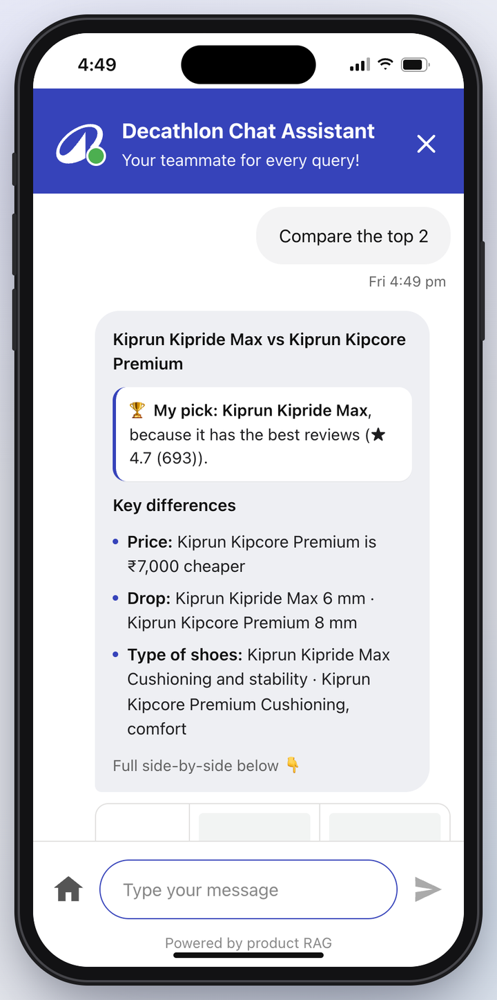 |  |
| Every matching product, ranked, with a pick | A clear verdict and the key differences | Price, rating, weight, material, specs, warranty |

| 4. "Add to cart" asks for your size | 5. Added from the chat | 6. It's in the real cart |
|:---:|:---:|:---:|
| 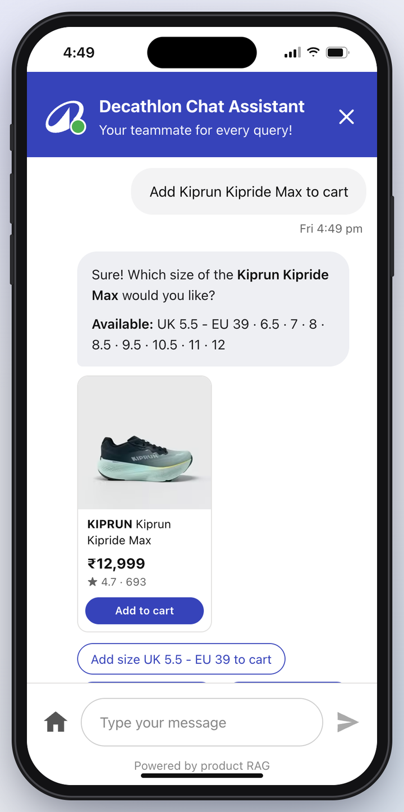 |  | 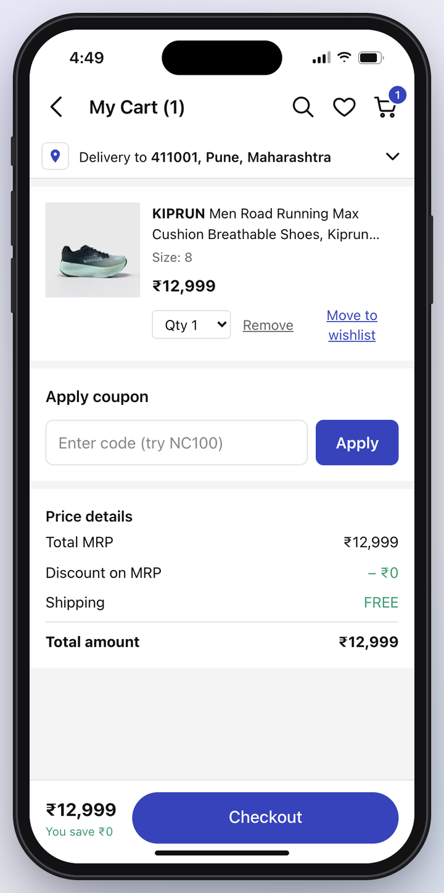 |
| One-tap size chips | Toast + "View my cart" | Same cart as the store, coupons included |

### More

| "Thick yoga mat for knees" | Notifications → chat deep link |
|:---:|:---:|
| 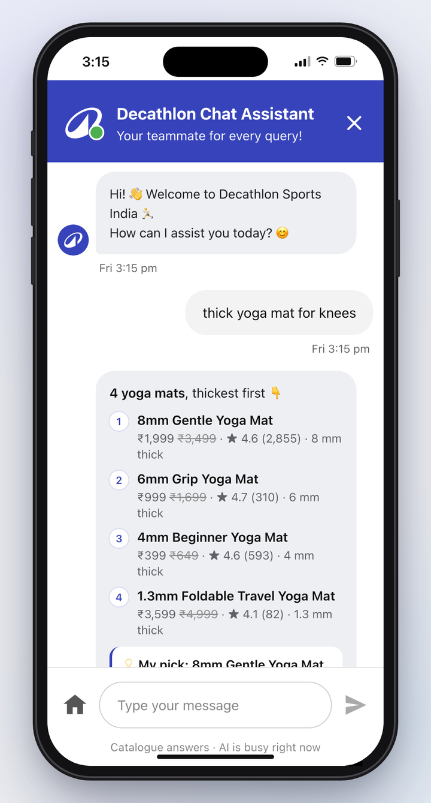 | 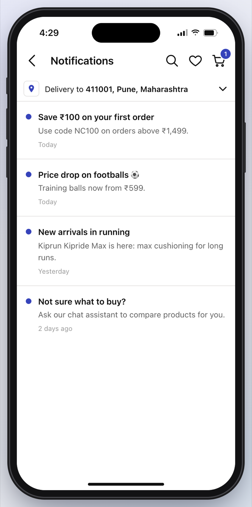 |

---

## 🛍️ The store app

| Screen | What you can do |
|---|---|
| **Home** `/` | Search bar, category circles, coupon strip (NC100 / NC200 / NC300), "Ask our assistant" banner, Bestsellers, Biggest discounts and per-category rails |
| **Category** `/c/[slug]` | Quick chips (Price low→high, Rating 4★+, Clearance, Price drop, New arrival), plus **Gender**, **Sort** and **Filter** (price bands, brand, rating) bottom sheets |
| **Search** `/search?q=` | Matches name, brand, category and sport, with popular categories and suggested searches |
| **Product** `/p/[id]` | Swipeable gallery with counter and thumbnails, offers, warranty/return/exchange badges, size picker (Add to cart asks for a size), delivery date countdown, Benefits / Technical info / Specifications / Material accordions, Frequently bought together, Similar, Recently viewed, ratings breakdown and reviews |
| **Cart** `/cart` | Quantity, remove, move to wishlist, coupon codes, price breakdown (MRP, discount, coupon, shipping) |
| **Wishlist**, **Notifications** | Saved items; offer notifications that deep-link into categories, products or a chat question |
| **Chat** `/chat` | The AI assistant. Opened from a product page, it already knows which product you're looking at. `/chat?q=...` asks a question straight away |

Cart, wishlist, recently viewed and delivery pincode are saved in the browser (localStorage).

---

## 🤖 The RAG shopping assistant

### How it works

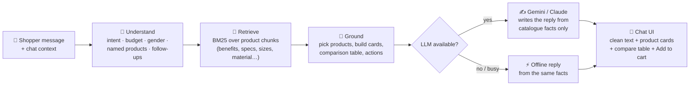

1. **Retrieval** (`lib/rag/index.ts`): every product is split into small chunks (overview, each benefit, each spec, technical Q&A, material, sizes, warranty) and scored with **BM25**. It handles synonyms (sneakers → shoes, bike → cycle), typo correction ("shose" → shoes), and ranks products by their best-matching chunk plus a boost when you use words from the product name.
2. **Understanding** (`lib/rag/assistant.ts`): detects categories and sports, budgets, who it's for, superlatives (cheapest, lightest, thickest, best rated, on sale), products named by model ("BR 100", "KS900"), links/IDs, ordinals ("the second one"), comparisons, add-to-cart, store FAQs and items we don't sell.
3. **Generation** (`lib/rag/llm.ts`, `lib/rag/gemini.ts`): the chosen products' full fact sheets plus the best snippets go to the LLM in a `<catalog_context>` block, with a strict "only use these facts" instruction. The rule-based answer is passed along as a factual draft.
4. **Streaming UI** (`app/api/chat/route.ts`, `app/chat/page.tsx`): cards and comparison tables arrive first, then the reply streams in, rendered by a small Markdown formatter (`components/RichText.tsx`) into numbered product rows, bullets and a highlighted "My pick".

### What you can ask

| Kind | Examples |
|---|---|
| Needs & use cases | "shoes for marathon with good cushioning", "bikes for mountain", "t shirt for running in summer", "backpack for a 3 day trek" |
| Budgets | "yoga mat below 1k", "under ₹1,500", "1000 se kam", "above 5000", "between 1000 and 3000" |
| Who it's for | "something for my wife who does yoga", "gift for a 10 year old who likes football" (adds a ball-size tip) |
| Superlatives | "cheapest badminton racket", "lightest trekking backpack" (real weights), "thick yoga mat for knees" (sorts by mm), "what's on sale" |
| Specific products | "Kipride Max vs Kipcore Premium", "compare BR 100 and BR Lite 900", "kitna price hai kiprun ks900", a pasted product link |
| Follow-ups | "the second one", "does the first one have pockets?", "is it waterproof?", "which one is lighter?", "show similar products", "what else goes with it?" |
| Actions | "add it to cart" → "Add size 8 to cart" (or tap **Add to cart** on any chat card) |
| Store questions | returns, delivery, store pickup, coupons, payments |
| Out of range | "do you have tennis rackets?" → honest "we don't stock that" + closest alternative; off-topic questions are politely declined |

### Reliability

- **Works with no API key**: the offline assistant answers from the same retrieved facts.
- **Gemini resilience**: low "thinking" for faster replies, a 12-second budget for the first words, a quick retry on "high demand" errors, a backup model, and a 2-minute cooldown where answers come instantly from the catalogue.
- **Regression tests**: `scripts/chat-eval/` holds 36 real shopper conversations (50 turns) that you can re-run after any change.

---

## 🚀 Getting started

**Requirements:** Node.js 20+ and npm.

```bash
git clone https://github.com/shashwatbuild/decath-clone-rag.git
cd decath-clone-rag/decath-mobile
npm install
npm run dev
```

Open **http://localhost:3000**. On a laptop you'll see the app inside a phone; resize the window under 640px (or open it on your phone) for full-screen.

### Turn on the AI (optional)

The assistant works without a key. To have **Gemini** (or **Claude**) write the replies:

```bash
cp .env.example .env.local
```

Then edit `decath-mobile/.env.local`:

```bash
GEMINI_API_KEY=your-gemini-key      # from https://aistudio.google.com/apikey
LLM_PROVIDER=gemini
```

Restart `npm run dev`. The chat footer shows **"Powered by Gemini + product RAG"** when the AI is answering, and **"Catalogue answers"** when it falls back. `.env.local` is gitignored, so your key never gets committed.

### Configuration

| Variable | Default | What it does |
|---|---|---|
| `GEMINI_API_KEY` | none | Enables Gemini replies |
| `ANTHROPIC_API_KEY` | none | Enables Claude replies (`claude-opus-5-5`) |
| `LLM_PROVIDER` | first key found | `gemini`, `claude` or `off` |
| `GEMINI_MODELS` | `gemini-3.8-flash,gemini-flash-latest` | Models to try, in order |
| `GEMINI_TIMEOUT_MS` | `12000` | Max wait for Gemini's first words before falling back |
| `GEMINI_THINKING` | `low` | Gemini thinking level |
| `CLAUDE_MODEL` | `claude-opus-5-5` | Claude model |

---

## 🧱 Tech stack

- **Next.js 15** (App Router, Turbopack) · **React 19** · **TypeScript** · **Tailwind CSS v4**
- **RAG**: custom BM25 retriever + intent engine in TypeScript (no vector DB needed for 32 products)
- **LLMs**: Gemini REST streaming API, Anthropic SDK (Claude), both optional
- **Data pipeline**: Python scripts that parse product pages into `products.json` (no browser automation, no executing site scripts)

## 📁 Project structure

```
decath-clone-rag/
├── decath-mobile/                 # the Next.js app
│   ├── app/
│   │   ├── page.tsx               # home
│   │   ├── c/[slug]/              # category listing
│   │   ├── p/[id]/                # product page
│   │   ├── search/ cart/ wishlist/ notifications/
│   │   ├── chat/page.tsx          # chat screen (streaming, cards, add to cart)
│   │   └── api/chat/route.ts      # chat API (NDJSON stream)
│   ├── components/
│   │   ├── PhoneFrame.tsx         # iPhone frame on desktop
│   │   ├── ProductView.tsx        # product page UI
│   │   ├── ListingView.tsx        # listing + sort/filter sheets
│   │   └── RichText.tsx           # renders assistant replies
│   ├── lib/
│   │   ├── rag/index.ts           # chunking + BM25 retrieval + typo correction
│   │   ├── rag/assistant.ts       # intent understanding + grounded replies
│   │   ├── rag/llm.ts             # prompt, context building, provider choice
│   │   ├── rag/gemini.ts          # Gemini streaming with fallbacks
│   │   ├── products.ts            # catalogue helpers
│   │   └── store.tsx              # cart / wishlist state
│   └── data/products.json         # 32 products, 8 categories
├── scripts/
│   ├── build_catalog.py           # product pages → products.json
│   └── chat-eval/                 # assistant regression conversations
└── docs/            # screenshots/ and demo/ (video + GIF)
```

## 📦 Product data

`decath-mobile/data/products.json` holds **32 products, 4 in each of 8 categories** (running shoes, yoga pants, yoga mats, trekking backpacks, footballs, badminton, cycles, t-shirts), collected from decathlon.in on 6 Nov 2026: prices, specs, benefits, sizes, weights, images and rating counts. Review texts and the star breakdown are generated sample data.

To refresh or add products, edit the IDs in `scripts/build_catalog.py`, save each product page as `<pdp_dir>/<id>.html` (from `https://www.decathlon.in/qr/<id>/-1`), then run:

```bash
python3 -I scripts/build_catalog.py <pdp_dir> decath-mobile/data/products.json
```

## 🧪 Testing the assistant

With the dev server running:

```bash
python3 scripts/chat-eval/run.py scripts/chat-eval/cases.json
```

It sends every conversation through `/api/chat` and prints the products picked and the reply, so you can spot regressions quickly.

---

## ⚠️ Disclaimer

This is a **personal learning / portfolio project** and is **not affiliated with, endorsed by, or connected to Decathlon**. "Decathlon", its logo, product names, product images and product descriptions belong to Decathlon and are used here only for non-commercial demonstration. Product images are loaded from Decathlon's public CDN, not stored in this repo. Checkout and payments are disabled.
