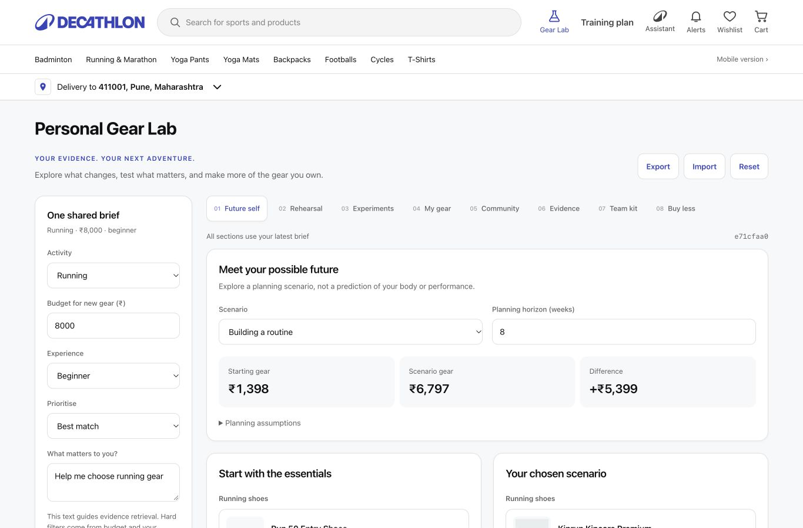
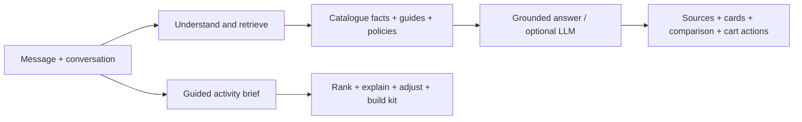

<div align="center">

# Decathlon Clone · RAG Shopping Assistant

**Problem:** sports shoppers must turn scattered specifications, budgets and existing gear into a confident decision. A fluent answer alone does not show whether a product actually meets their needs.

**Why I built this:** a personal project that brings shopping, source-backed advice and practical gear planning into one consistent desktop/mobile experience.

**The solution:** RAG retrieves catalogue facts and guides; explicit rules check budgets, stock and requirements. Gear Lab adds ownership, scenarios and shared-kit planning, while a local camera preview helps explore clothing colours and silhouettes.

**87 products · 19 categories · 5 guided advisor profiles · 8 Gear Lab tools · Live 2D outfit preview**

[Features & benefits](docs/FEATURES.md) · [Gear Lab & camera guide](docs/GEAR_LAB.md) · [Screenshots](docs/SCREENSHOTS.md) · [Architecture](docs/ARCHITECTURE.md) · [Next ideas](docs/ROADMAP.md)



</div>

## New: Gear Lab and live preview

| Capability | What you can do | Benefit |
|---|---|---|
| **Future sporting self** | Compare a starting kit with a selected progression scenario. | See what changes before spending; no fitness prediction is claimed. |
| **Conditions rehearsal** | Check catalogue evidence against rain, outdoor use and longer sessions. | Surface unknowns and preparation questions early. |
| **Next best experiment** | Answer a question that separates the current candidates. | Reduce uncertainty with fewer questions. |
| **Gear memory** | Record owned products, condition, use, comfort and repairs. | Reuse equipment and keep a practical care record. |
| **Community fit** | Opt in to product/size feedback and delete your device's contributions. | Learn from aggregate reports once at least five distinct device tokens contribute. |
| **Evidence contracts** | Inspect match, mismatch and unknown checks with a revision fingerprint. | Understand why an item qualifies before adding it. |
| **Team kit** | Plan for up to six people with individual budgets and shared shuttles. | Avoid duplicate shared equipment and budget overruns. |
| **Buy-less advocate** | Review reuse, maintenance, borrowing and deferred purchases. | Make a useful kit with fewer new purchases. |
| **Live outfit preview** | Use a camera with a pose-following 2D overlay or manual alignment. | Explore supported clothing visually, without uploading camera frames. |

Available for **running, badminton, yoga and trekking**. These are working, bounded implementations of the ideas, not physical simulation, lifespan prediction or photorealistic virtual fitting. [Practical scope, privacy and setup →](docs/GEAR_LAB.md)

## What does it do?

| Feature | Benefit for the shopper |
|---|---|
| **Ask naturally** | Find gear by sport, use, budget, recipient or product name, with typo handling and conversational follow-ups. |
| **Get evidence** | Read catalogue-based answers with source links and an expandable retrieval explanation. |
| **Compare options** | See specifications, reasons to choose each product, and trade-offs in one place. |
| **Personalise the pick** | Edit an activity brief, distinguish must-haves from preferences, and explore “What changes if…?” with Undo. |
| **Build a sport kit** | Skip gear you already own, set a separate kit budget, and add selected items with sizes to the cart. |
| **Plan purchases** | Spread gear purchases across a week-by-week timeline for badminton, running, yoga or trekking. |
| **Shop end to end** | Browse, filter, save products, find a suggested size, use coupons and try simulated checkout. |
| **Keep getting answers** | Catalogue answers remain available when no AI key is configured or the model is unavailable. |

Guided advisors cover **yoga pants, yoga mats, trekking backpacks, badminton rackets and running shoes**. Kits cover yoga, badminton and marathon gear. [See the complete feature matrix →](docs/FEATURES.md)

## See it in action

| Mobile storefront | Guided advisor | Cited answers |
|:---:|:---:|:---:|
|  |  |  |

[Explore all screenshots, including comparison, Undo, kit budgets, planner and checkout →](docs/SCREENSHOTS.md)

## How is this different from Decathlon’s chatbot?

This project explores **helping a shopper make a buying decision** through an editable brief, visible evidence, trade-offs, reversible changes and ownership-aware kits.

Decathlon India’s [official support page](https://www.decathlon.in/support/695/decathlon-sports-india-customer-support-channels) directs customers to chat on its website/app for quick resolution. That verifies a customer-support channel; it does not establish its complete AI feature set.

| Area | This project | Decathlon’s official experience |
|---|---|---|
| Purpose | A demonstrable shopping-decision assistant plus a store prototype. | Official customer-support chat is publicly documented. |
| Choosing gear | Editable brief, must-haves, trade-offs, comparison and “What changes if…?” with Undo. | Equivalent chatbot workflows were not established by the reviewed official source. |
| Explaining answers | Source citations, catalogue evidence and a visible retrieval trace. | Equivalent source/trace controls were not established by the reviewed official source. |
| Building a kit | Owned-item logs, scenario/conditions checks, buy-less advice, individual team budgets and shared-item allocation. | Equivalent chatbot kit controls were not established by the reviewed official source. |
| Real operations | Bundled catalogue and simulated checkout; no fulfilment or live order management. | A live retailer with official support channels. This prototype does not replace them. |

**Comparison scope:** public official information reviewed on 26 November 2026. “Not established” does not mean a feature is absent. No claim is made that this prototype outperforms Decathlon’s current chatbot; that would require testing the same tasks in both systems.

## Try these prompts

| Goal | Prompt |
|---|---|
| Find a product | “Lightest trekking backpack” |
| Get a personalised pick | “I’m starting yoga and want pants under ₹1,000” |
| Compare | “Compare BR 100 and BR Lite 900” |
| Understand gear | “Feather or plastic shuttlecocks?” |
| Build a kit | “Help me build a badminton kit” |
| Plan purchases | “Training plan for a 10K in 8 weeks, budget ₹5,000” |
| Take an action | “Add the first one to cart” |

## Run locally

Requires Node.js 20+ and npm.

```bash
git clone https://github.com/shashwatbuild/decath-clone-rag.git
cd decath-clone-rag/decath-mobile
npm install
npm run dev
```

| View | Local URL |
|---|---|
| Responsive app | [localhost:3000](http://localhost:3000) |
| Desktop preview | [localhost:3000/d](http://localhost:3000/d) |
| Mobile phone preview | [localhost:3000/m](http://localhost:3000/m) |
| Chatbot | [localhost:3000/chat](http://localhost:3000/chat) |
| Gear Lab | [localhost:3000/lab](http://localhost:3000/lab) |
| Live outfit preview | [localhost:3000/try-on](http://localhost:3000/try-on) |

If the native compiler is unavailable, install the Next.js SWC package matching your platform and installed Next.js version. The standard server can also be started with `npm run dev` without Turbopack (the default). `npm run dev:turbo` is optional.

**Optional AI:** copy `.env.example` to `.env.local`, add a Gemini or Anthropic key, and set `LLM_PROVIDER=gemini` or `claude`. Set `LLM_PROVIDER=off` for catalogue-only answers. Keep API keys out of Git. Model identifiers are configurable; see [configuration](docs/ARCHITECTURE.md#configuration).

## How it works



**Stack:** Next.js 15 · React 19 · TypeScript · Tailwind CSS 4 · BM25 + hybrid retrieval · optional Gemini / Claude. Retrieval does not require embeddings or a vector database. [Implementation details →](docs/ARCHITECTURE.md)

## Checks and limitations

```bash
cd decath-mobile
npm test
npm run lint
npm run build
```

The retrieval and advisor suites plus 42 Gear Lab/API checks pass. Browser checks cover desktop/mobile layouts, source contracts, ownership logs, discriminating questions and the pose engine. Camera opening was confirmed by the user; alignment remains an approximate preview that needs real-device validation. Hybrid retrieval found a relevant source in the top 3 for **97% of 32 tuning questions** and **100% of 12 held-out questions**. These are small regression sets, not general accuracy claims. The API conversation runner is documented in the [architecture guide](docs/ARCHITECTURE.md#validation).

| Demo boundary | What to expect |
|---|---|
| Product data | Bundled catalogue, not live price or inventory sync. Product images load from Decathlon’s CDN. |
| Payments and delivery | Demo wallet/COD checkout only; no real money moves or products ship. Delivery estimates are rules, not courier data. |
| Price watch | Local target-price checks; no background monitoring, email or push service. |
| Preferences and memory | Browser-local state with Gear Lab export/import and reset; no accounts or automatic cross-device sync. |
| Community fit | Opt-in server-side device-token reports; only groups of five or more are displayed. Requires persistent single-host storage. |
| Camera preview | Local 2D approximation for supported clothing; no size, drape or fit guarantee. Model/runtime downloads require internet. |
| Recommendations | Based on available catalogue fields; size suggestions are heuristics, and missing facts remain unknown. |
| Reviews and policies | Review text/star breakdowns are sample data; store policies describe this demo. |
| AI answers | Citations and fallback reduce risk but do not prove every generated claim is correct. |

---

Personal learning / portfolio project. **Not affiliated with or endorsed by Decathlon.** Decathlon’s brand, product names, photos and descriptions belong to their respective owners and are used for non-commercial demonstration.
