<div align="center">

# 🏃 Decathlon Mobile Clone + RAG Shopping Assistant

**A pixel-faithful mobile sports store, with an AI shopping assistant that actually knows the catalogue.**

Browse 40 real products (including 12 yoga pants), filter and sort, compare gear, add to cart, and ask the assistant things like
*"lightest trekking backpack"*, *"compare Kipride Max vs Kipcore Premium"* or *"I'm starting yoga and want pants under ₹1,000"*,
and get grounded answers, an editable activity brief, honest trade-offs and "what changes if…?" controls.


-d97757?logo=anthropic&logoColor=white)


<br/>


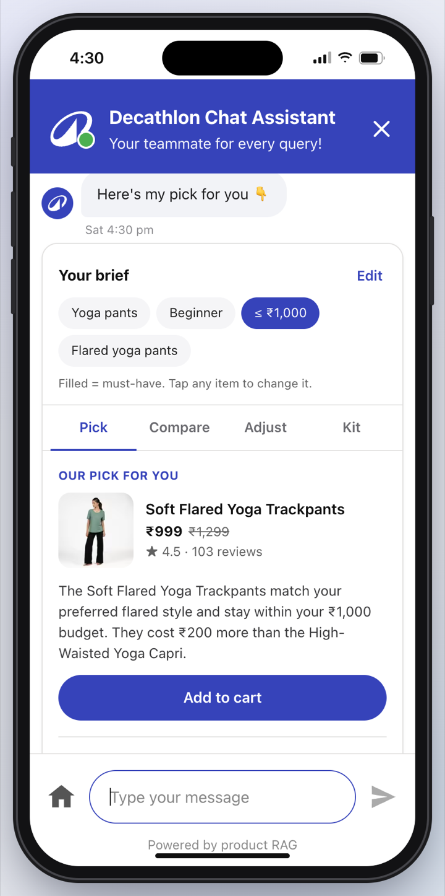
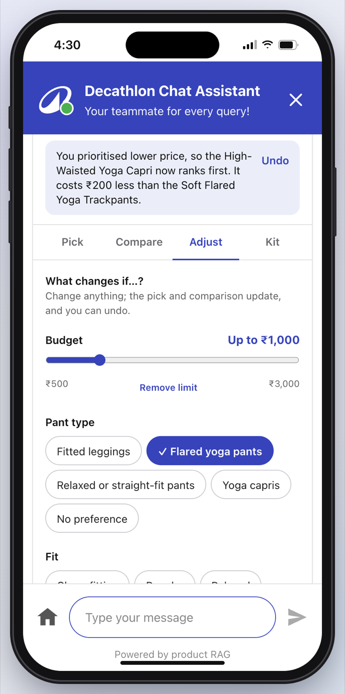

**🎬 [Watch the 2½-minute demo video (MP4, 1080p): store → search → RAG answers & comparison → pant type → activity brief → trade-offs → what changes if…? → activity kit → cart](docs/demo/decathlon-clone-demo.mp4)**

</div>

---

## ✨ Highlights

- 📱 **Looks like a real phone app**: on a laptop it runs inside an iPhone frame (Dynamic Island, live clock, home bar); on a real phone it's full-screen.
- 🛍️ **Complete shopping flow**: home, categories, search, filters & sort, rich product pages, wishlist, cart with coupons, notifications.
- 🤖 **RAG shopping assistant**: retrieves facts from the catalogue (BM25 over product chunks), understands intent, then writes the answer, offline or with **Gemini** / **Claude**.
- 🧠 **Understands real shopper language**: budgets ("under 2k", "1000 se kam"), who it's for ("for my wife"), needs ("good cushioning", "for knees"), follow-ups ("the second one"), typos ("shose").
- 🧭 **Personalised shopping advisor**: starts with the **type of pants** you want, builds an editable **activity brief** (must-haves vs preferences), recommends with **trade-offs and evidence**, lets you explore **"What changes if…?"** with Undo, and builds an **activity kit** that skips what you already own.
- 🛒 **Takes actions**: "add it to cart" asks for your size, then adds it to the real cart.
- ✅ **Honest by design**: answers only from catalogue facts, says when something isn't stocked, and keeps working if the AI is down.

---

## 📸 Screenshots

### Store

| Home | Category | Product page | Search |
|:---:|:---:|:---:|:---:|
|  |  |  |  |

### AI shopping assistant: ask → compare → add to cart

| 1. "Running shoes for a marathon" | 2. "Compare the top 2" | 3. The full comparison table |
|:---:|:---:|:---:|
|  |  |  |
| Every matching product, ranked, with a pick | A clear verdict and the key differences | Price, rating, weight, material, specs, warranty |

| 4. "Add to cart" asks for your size | 5. Added from the chat | 6. It's in the real cart |
|:---:|:---:|:---:|
|  |  |  |
| One-tap size chips | Toast + "View my cart" | Same cart as the store, coupons included |

### Personalised shopping advisor: pant type → pick → compare → what changes if…? → kit

*"I'm starting yoga and want pants under ₹1,000"*: the assistant keeps what you said (yoga, beginner, ₹1,000), starts with the **type of pants** you want, then shows one tidy card: your brief as chips, one change note with Undo, and four tabs (**Pick · Compare · Adjust · Kit**).

| 1. Pick your type of yoga pants | 2. Up to two quick questions | 3. One clear pick |
|:---:|:---:|:---:|
| 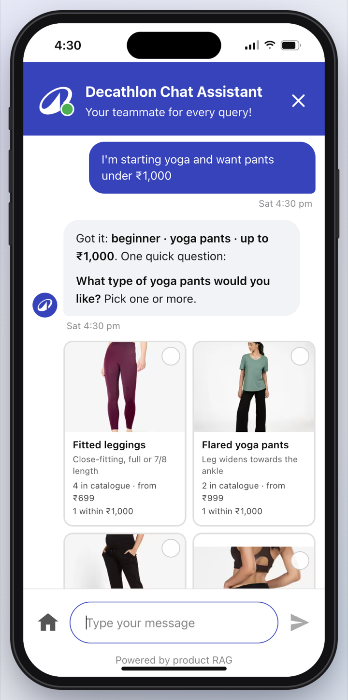 | 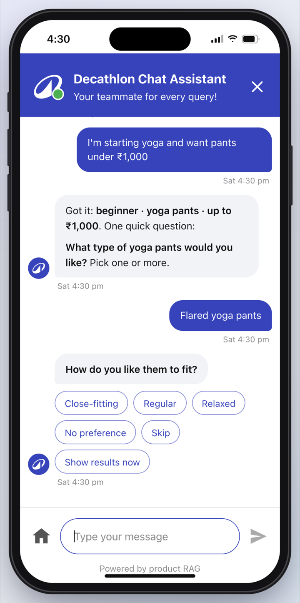 |  |
| Cards from the catalogue; choose several, "Help me choose" or "No preference" | Each skippable; nothing asked twice | Brief chips (filled = must-have) and a one-line reason |

| 4. Details fold away | 5. Product evidence | 6. Your brief, in full |
|:---:|:---:|:---:|
| 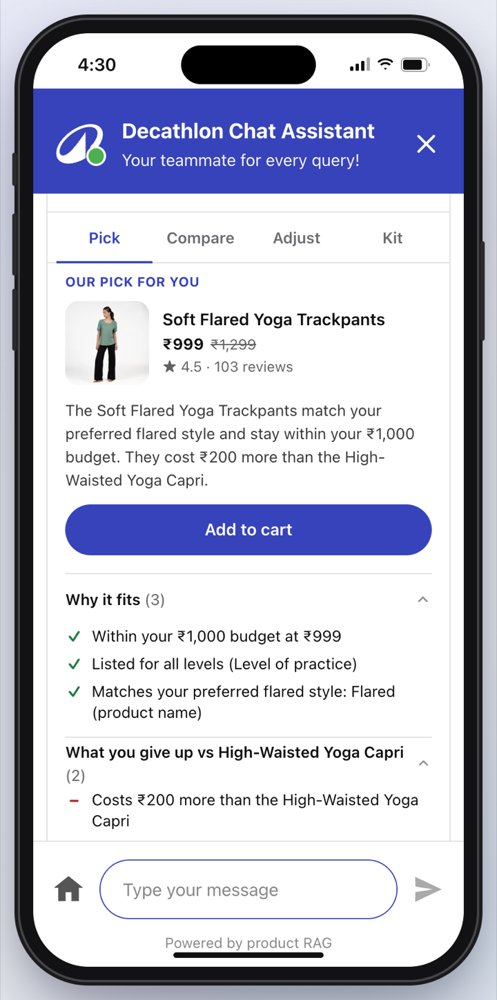 | 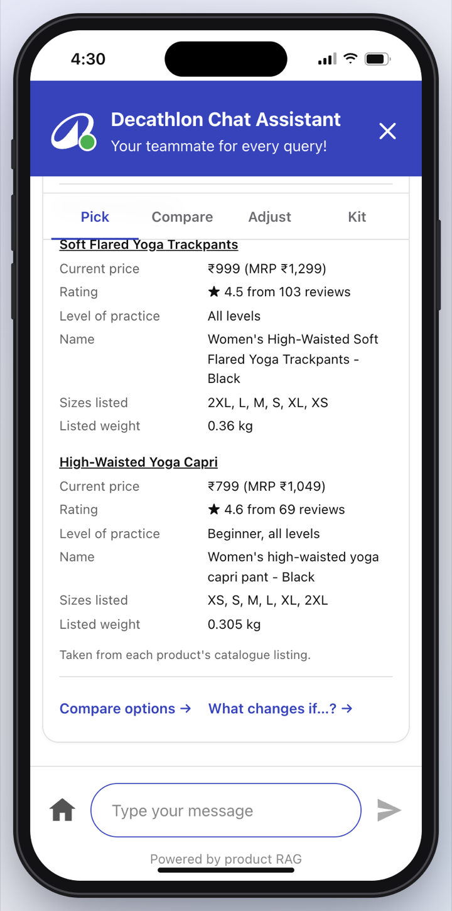 | 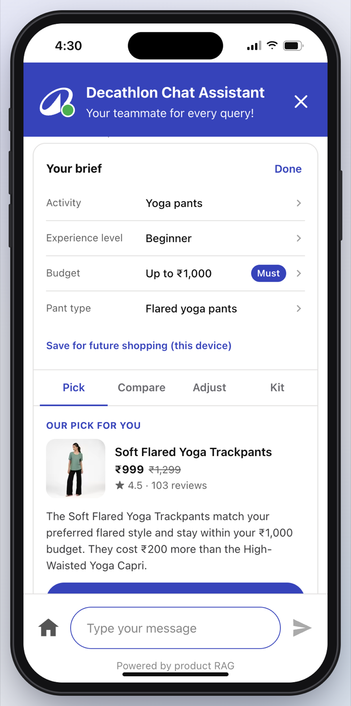 |
| Why it fits · what you give up · still to check | Every claim maps to a catalogue field | Only what you told it; tap a row to edit |

| 7. Compare "For your needs" | 8. "All specifications" | 9. What changes if…? "Lowest price" |
|:---:|:---:|:---:|
| 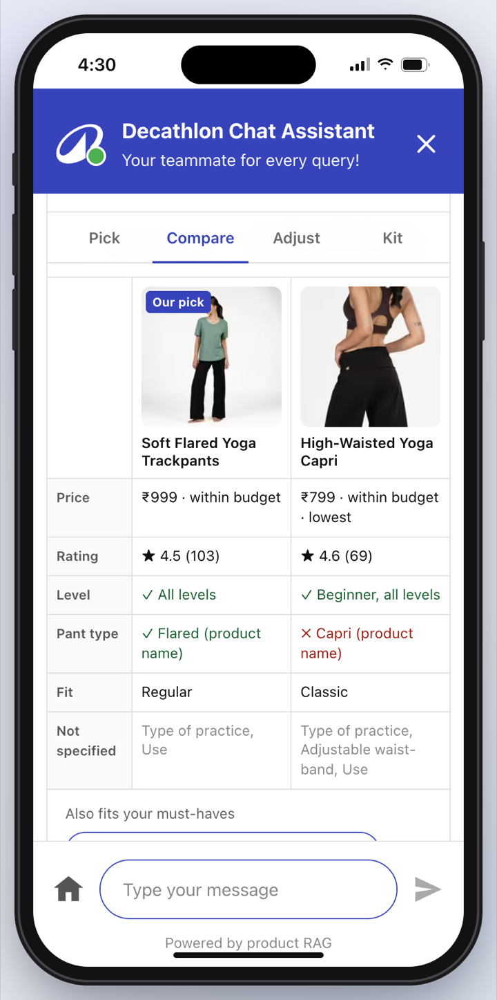 | 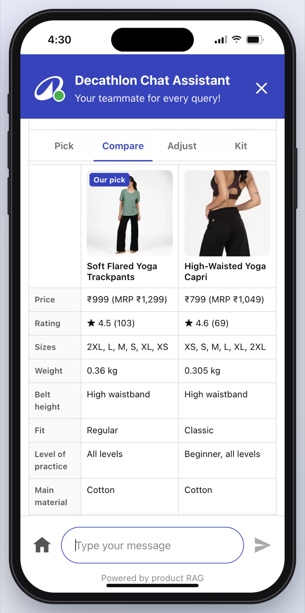 |  |
| ✓ / ✗ against your brief, "Not specified" when missing | Every field side by side | One note explains the effect, with Undo |

| 10. The pick updates | 11. Undo restores it | 12. Refine my preferences |
|:---:|:---:|:---:|
| 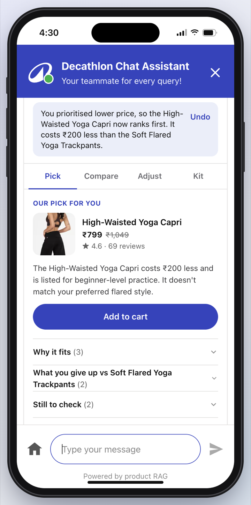 | 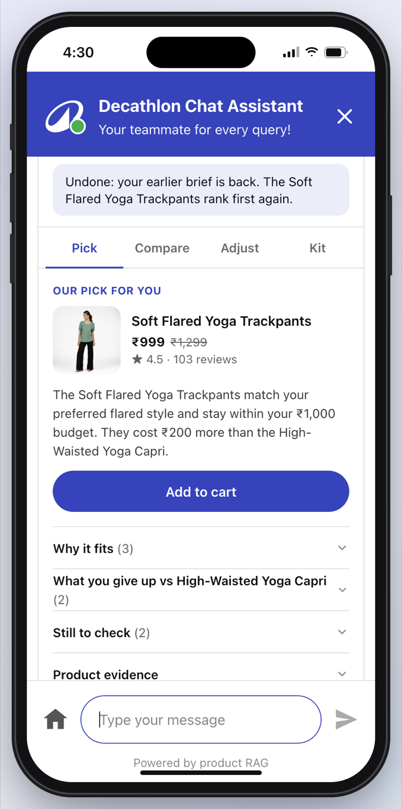 | 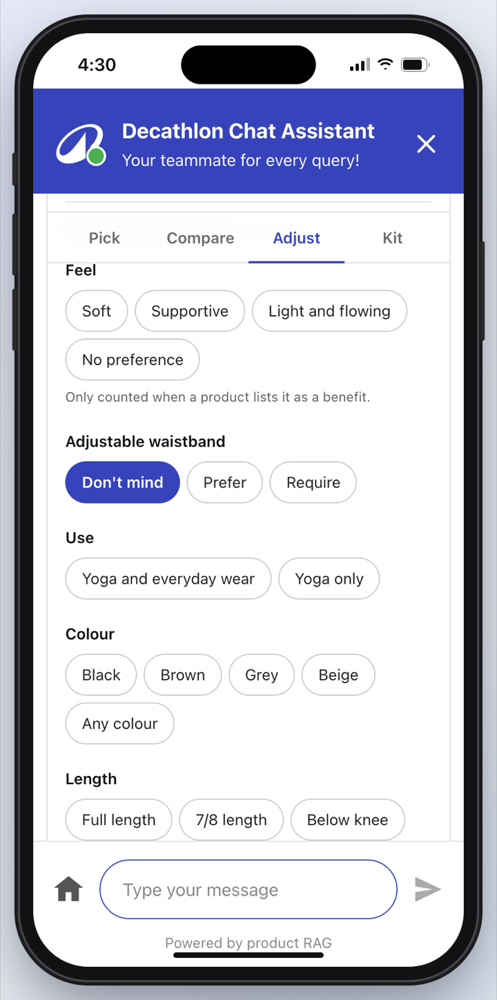 |
| Capri ranks first: "₹200 less than the trackpants" | Brief, ranking, comparison and kit roll back | Feel, waistband, use, colour, length |

| 13. Build my activity kit | 14. Owned mat, skipped strap | 15. Separate kit budget |
|:---:|:---:|:---:|
| 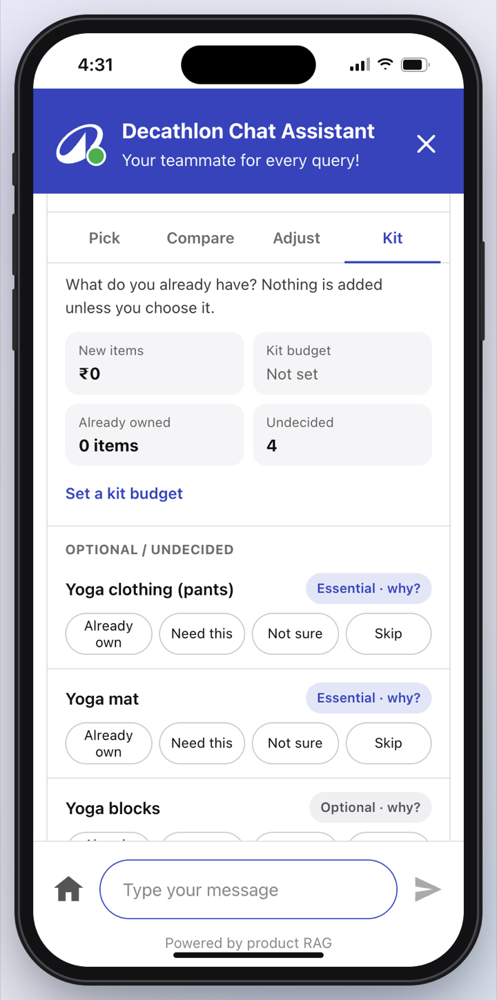 | 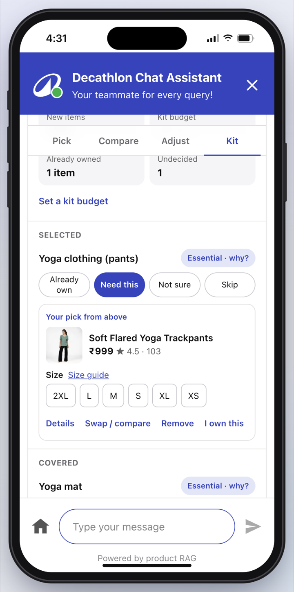 | 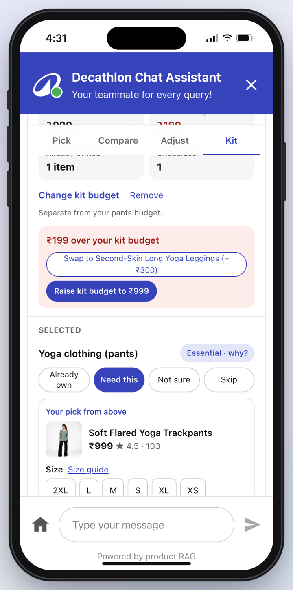 |
| Already own / Need this / Not sure / Skip; nothing assumed | Your pants carry over without duplicates; size before cart | Over budget? Cheaper swaps, or raise it yourself |

| Must-have in a bottom sheet | Flared required: capri marked | No match? Explicit choices | Another sport, own criteria | Backpack controls |
|:---:|:---:|:---:|:---:|:---:|
| 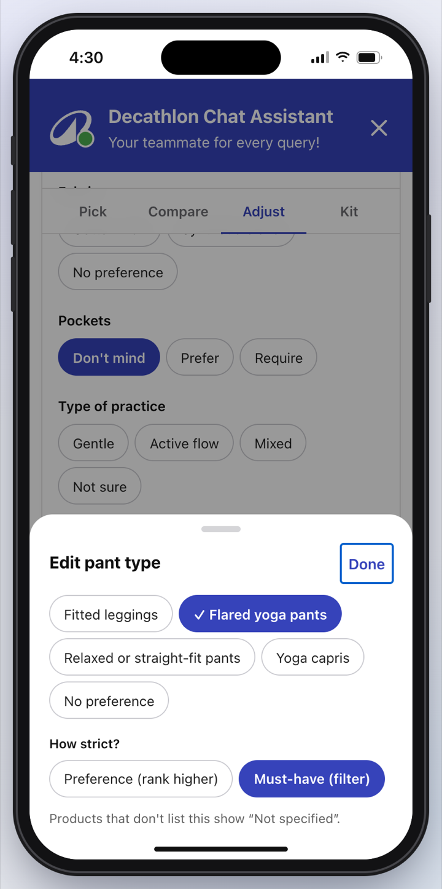 | 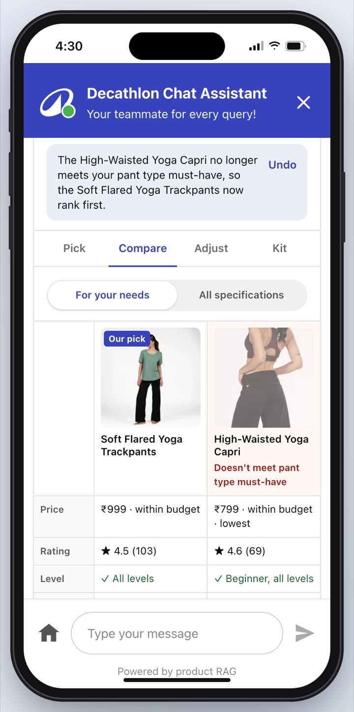 | 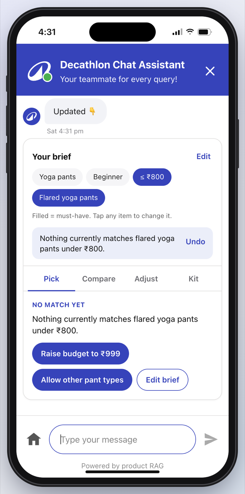 | 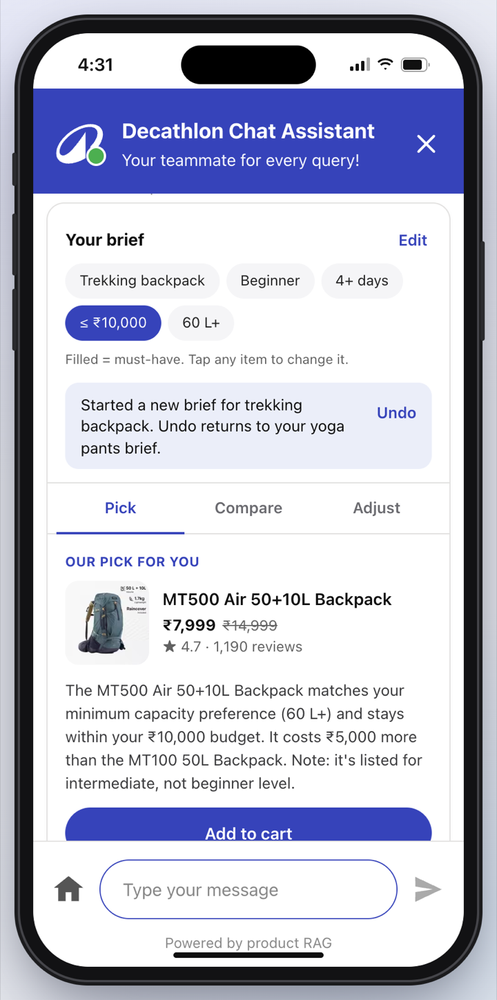 | 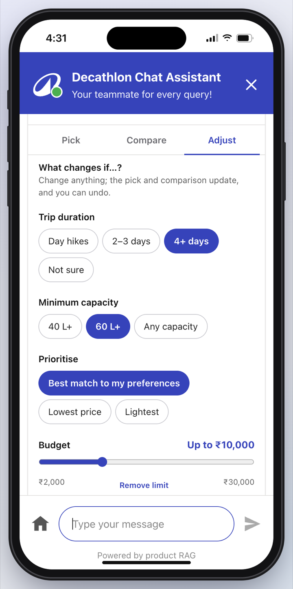 |

### More

| "Thick yoga mat for knees" (guided flow) | Notifications → chat deep link |
|:---:|:---:|
|  |  |

---

## 🛍️ The store app

| Screen | What you can do |
|---|---|
| **Home** `/` | Search bar, category circles, coupon strip (NC100 / NC200 / NC300), "Ask our assistant" banner, Bestsellers, Biggest discounts and per-category rails |
| **Category** `/c/[slug]` | Quick chips (Price low→high, Rating 4★+, Clearance, Price drop, New arrival), plus **Gender**, **Sort** and **Filter** (price bands, brand, rating) bottom sheets |
| **Search** `/search?q=` | Matches name, brand, category and sport, with popular categories and suggested searches |
| **Product** `/p/[id]` | Swipeable gallery with counter and thumbnails, offers, warranty/return/exchange badges, size picker (Add to cart asks for a size), delivery date countdown, Benefits / Technical info / Specifications / Material accordions, Frequently bought together, Similar, Recently viewed, ratings breakdown and reviews |
| **Cart** `/cart` | Quantity, remove, move to wishlist, coupon codes, price breakdown (MRP, discount, coupon, shipping) |
| **Wishlist**, **Notifications** | Saved items; offer notifications that deep-link into categories, products or a chat question |
| **Chat** `/chat` | The AI assistant. Opened from a product page, it already knows which product you're looking at. `/chat?q=...` asks a question straight away |

Cart, wishlist, recently viewed and delivery pincode are saved in the browser (localStorage).

---

## 🤖 The RAG shopping assistant

### How it works

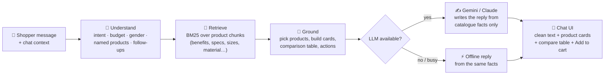

1. **Retrieval** (`lib/rag/index.ts`): every product is split into small chunks (overview, each benefit, each spec, technical Q&A, material, sizes, warranty) and scored with **BM25**. It handles synonyms (sneakers → shoes, bike → cycle), typo correction ("shose" → shoes), and ranks products by their best-matching chunk plus a boost when you use words from the product name.
2. **Understanding** (`lib/rag/assistant.ts`): detects categories and sports, budgets, who it's for, superlatives (cheapest, lightest, thickest, best rated, on sale), products named by model ("BR 100", "KS900"), links/IDs, ordinals ("the second one"), comparisons, add-to-cart, store FAQs and items we don't sell.
3. **Generation** (`lib/rag/llm.ts`, `lib/rag/gemini.ts`): the chosen products' full fact sheets plus the best snippets go to the LLM in a `<catalog_context>` block, with a strict "only use these facts" instruction. The rule-based answer is passed along as a factual draft.
4. **Streaming UI** (`app/api/chat/route.ts`, `app/chat/page.tsx`): cards and comparison tables arrive first, then the reply streams in, rendered by a small Markdown formatter (`components/RichText.tsx`) into numbered product rows, bullets and a highlighted "My pick".

### What you can ask

| Kind | Examples |
|---|---|
| Needs & use cases | "shoes for marathon with good cushioning", "bikes for mountain", "t shirt for running in summer", "backpack for a 3 day trek" |
| Budgets | "yoga mat below 1k", "under ₹1,500", "1000 se kam", "above 5000", "between 1000 and 3000" |
| Who it's for | "something for my wife who does yoga", "gift for a 10 year old who likes football" (adds a ball-size tip) |
| Superlatives | "cheapest badminton racket", "lightest trekking backpack" (real weights), "thick yoga mat for knees" (sorts by mm), "what's on sale" |
| Specific products | "Kipride Max vs Kipcore Premium", "compare BR 100 and BR Lite 900", "kitna price hai kiprun ks900", a pasted product link |
| Follow-ups | "the second one", "does the first one have pockets?", "is it waterproof?", "which one is lighter?", "show similar products", "what else goes with it?" |
| Actions | "add it to cart" → "Add size 8 to cart" (or tap **Add to cart** on any chat card) |
| Store questions | returns, delivery, store pickup, coupons, payments |
| Out of range | "do you have tennis rackets?" → honest "we don't stock that" + closest alternative; off-topic questions are politely declined |

### Reliability

- **Works with no API key**: the offline assistant answers from the same retrieved facts.
- **Gemini resilience**: low "thinking" for faster replies, a 12-second budget for the first words, a quick retry on "high demand" errors, a backup model, and a 2-minute cooldown where answers come instantly from the catalogue.
- **Regression tests**: `scripts/chat-eval/` holds 36 real shopper conversations (50 turns) that you can re-run after any change.

### Personalised shopping advisor

For yoga pants, yoga mats and trekking backpacks, a request that describes a need ("I'm starting yoga and want pants under ₹1,000", "lightest trekking backpack for a 4 day trek", "compare 2 yoga mats for beginners") starts a guided flow. It runs on the device, so changes are instant and can't race.

- **Pant type first** (`lib/advisor/profiles.ts`): visual cards for fitted leggings, flared, relaxed/straight-fit and capris, read from product names and the listed fit. Length is only an optional refinement. "Help me choose" asks fit and practice, then explains each type from catalogue facts without picking one for you.
- **Activity brief** (`lib/advisor/session.ts`): extracts activity, level, budget and preferences from the message, then asks at most 2 more questions, and only those whose answer would separate the products still in play (Skip / Not sure / No preference). Fit, waist, fabric, pockets, adjustable waistband, feel, everyday use, colour and length sit under **Refine my preferences**. A stated budget is a must-have; everything else is a preference unless you make it a must-have.
- **One source of truth**: chat messages ("make it under 800"), brief edits and "What changes if…?" controls all commit to the same session, with a short "what changed" summary and multi-step **Undo**.
- **Filter → rank → explain** (`lib/advisor/engine.ts`): must-haves decide eligibility (never silently relaxed); eligible products are ranked by your priority and preferences; the deciding reason is recorded. No percentage scores: if the data can't separate two products, it says **"Both are suitable"**.
- **Explanations from facts only** (`lib/advisor/explain.ts`): every sentence is built from the ranking reasons and catalogue fields, with a "View product evidence" panel. Missing data shows as **"Not specified"**, and a control whose data is missing says it "can't be evaluated" instead of faking a change.
- **Only catalogue-backed preferences**: "soft" or "supportive" match only when a product lists that benefit (otherwise "not listed", never a mismatch); missing fit or waist data shows as "Not specified".
- **Activity kit** (`lib/advisor/kit.ts`): mark mat, clothing, blocks and strap as *Already own*, *Need this*, *Not sure* or *Skip*. Owned and skipped items never appear in suggestions or totals; the pants you chose carry over without duplicates; the kit budget is separate from the pants budget; only selected new items with sizes chosen can be added to the cart (items already in it aren't added twice). Blocks and straps aren't in this demo catalogue, so the kit says so instead of inventing products.
- **Profiles per sport** (`lib/advisor/profiles.ts`): each category defines its own criteria, questions and controls (yoga: pant type, fit, waist, fabric, pockets, practice; backpacks: trip duration, capacity, weight). Adding a sport is adding a profile.
- **Saved preferences** are opt-in and stored on this device only (there are no accounts); the budget is never saved.

---

## 🚀 Getting started

**Requirements:** Node.js 20+ and npm.

```bash
git clone https://github.com/shashwatbuild/decath-clone-rag.git
cd decath-clone-rag/decath-mobile
npm install
npm run dev
```

Open **http://localhost:3000**. On a laptop you'll see the app inside a phone; resize the window under 640px (or open it on your phone) for full-screen.

### Turn on the AI (optional)

The assistant works without a key. To have **Gemini** (or **Claude**) write the replies:

```bash
cp .env.example .env.local
```

Then edit `decath-mobile/.env.local`:

```bash
GEMINI_API_KEY=your-gemini-key      # from https://aistudio.google.com/apikey
LLM_PROVIDER=gemini
```

Restart `npm run dev`. The chat footer shows **"Powered by Gemini + product RAG"** when the AI is answering, and **"Catalogue answers"** when it falls back. `.env.local` is gitignored, so your key never gets committed.

### Configuration

| Variable | Default | What it does |
|---|---|---|
| `GEMINI_API_KEY` | none | Enables Gemini replies |
| `ANTHROPIC_API_KEY` | none | Enables Claude replies (`claude-opus-5-5`) |
| `LLM_PROVIDER` | first key found | `gemini`, `claude` or `off` |
| `GEMINI_MODELS` | `gemini-3.8-flash,gemini-flash-latest` | Models to try, in order |
| `GEMINI_TIMEOUT_MS` | `12000` | Max wait for Gemini's first words before falling back |
| `GEMINI_THINKING` | `low` | Gemini thinking level |
| `CLAUDE_MODEL` | `claude-opus-5-5` | Claude model |

---

## 🧱 Tech stack

- **Next.js 15** (App Router, Turbopack) · **React 19** · **TypeScript** · **Tailwind CSS v4**
- **RAG**: custom BM25 retriever + intent engine in TypeScript (no vector DB needed for 40 products)
- **LLMs**: Gemini REST streaming API, Anthropic SDK (Claude), both optional
- **Data pipeline**: Python scripts that parse product pages into `products.json` (no browser automation, no executing site scripts)

## 📁 Project structure

```
decath-clone-rag/
├── decath-mobile/                 # the Next.js app
│   ├── app/
│   │   ├── page.tsx               # home
│   │   ├── c/[slug]/              # category listing
│   │   ├── p/[id]/                # product page
│   │   ├── search/ cart/ wishlist/ notifications/
│   │   ├── chat/page.tsx          # chat screen (streaming, cards, add to cart)
│   │   └── api/chat/route.ts      # chat API (NDJSON stream)
│   ├── components/
│   │   ├── PhoneFrame.tsx         # iPhone frame on desktop
│   │   ├── ProductView.tsx        # product page UI
│   │   ├── ListingView.tsx        # listing + sort/filter sheets
│   │   ├── RichText.tsx           # renders assistant replies
│   │   └── advisor/               # AdvisorPanel, TypeCards, KitBoard
│   ├── lib/
│   │   ├── rag/index.ts           # chunking + BM25 retrieval + typo correction
│   │   ├── rag/assistant.ts       # intent understanding + grounded replies
│   │   ├── rag/llm.ts             # prompt, context building, provider choice
│   │   ├── rag/gemini.ts          # Gemini streaming with fallbacks
│   │   ├── advisor/               # shopping advisor: profiles, engine, explanations, session, kit
│   │   ├── products.ts            # catalogue helpers
│   │   └── store.tsx              # cart / wishlist state
│   └── data/products.json         # 40 products, 8 categories
├── scripts/
│   ├── build_catalog.py           # product pages → products.json
│   └── chat-eval/                 # assistant regression conversations
└── docs/            # screenshots/ and demo/ (video + GIF)
```

## 📦 Product data

`decath-mobile/data/products.json` holds **40 products in 8 categories**: 12 yoga pants (leggings, flared, relaxed and capri styles) and 4 each of running shoes, yoga mats, trekking backpacks, footballs, badminton, cycles and t-shirts, collected from decathlon.in on 6–7 Nov 2026: prices, specs, benefits, sizes, weights, images and rating counts. Review texts and the star breakdown are generated sample data.

To refresh or add products, edit the IDs in `scripts/build_catalog.py`, save each product page as `<pdp_dir>/<id>.html` (from `https://www.decathlon.in/qr/<id>/-1`), then run:

```bash
python3 -I scripts/build_catalog.py <pdp_dir> decath-mobile/data/products.json
```

## 🧪 Testing the assistant

With the dev server running:

```bash
python3 scripts/chat-eval/run.py scripts/chat-eval/cases.json
```

It sends every conversation through `/api/chat` and prints the products picked and the reply, so you can spot regressions quickly.

The shopping advisor has its own checks (demo journey, budget conflicts, undo, missing data, other sports), no server needed:

```bash
cd decath-mobile && node scripts/advisor-check.mjs
```

---

## ⚠️ Disclaimer

This is a **personal learning / portfolio project** and is **not affiliated with, endorsed by, or connected to Decathlon**. "Decathlon", its logo, product names, product images and product descriptions belong to Decathlon and are used here only for non-commercial demonstration. Product images are loaded from Decathlon's public CDN, not stored in this repo. Checkout and payments are disabled.
