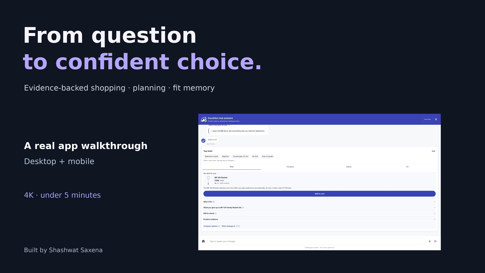
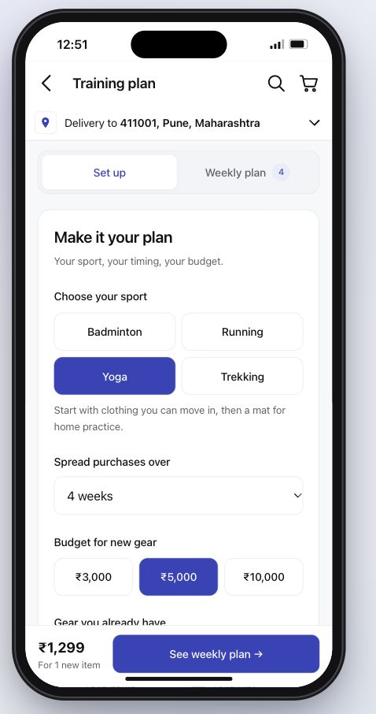
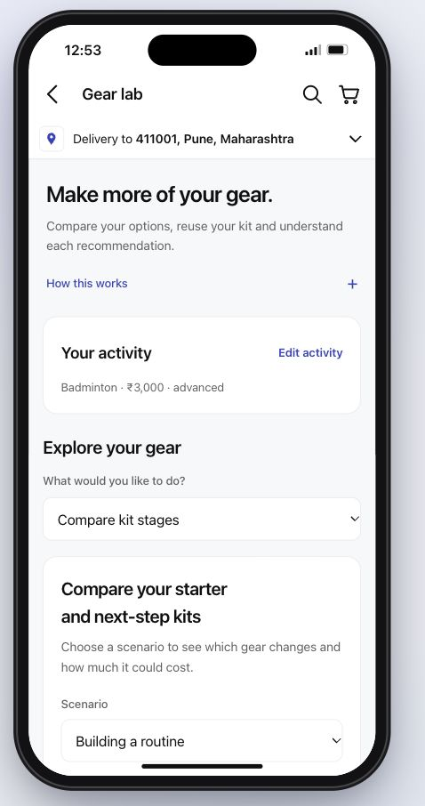
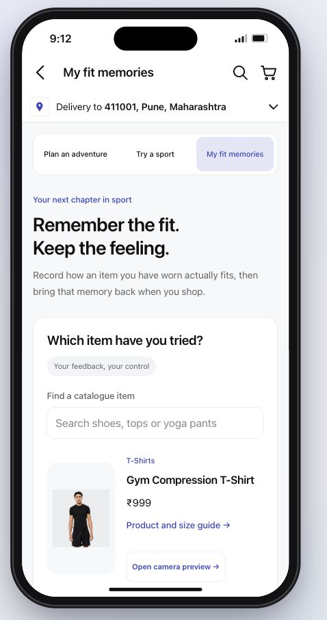
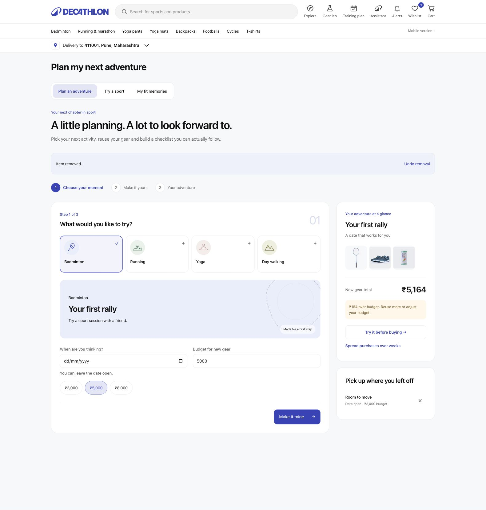
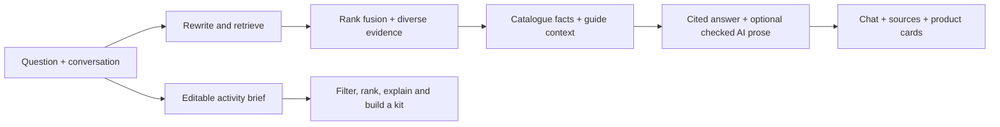

<div align="center">


# Decathlon clone · RAG sports companion

**Find the right gear. Reuse what you own. Plan what comes next.**

A personal project combining an evidence-backed chatbot, interactive sports planning and a responsive desktop/mobile store.

**87 products · 19 categories · 8 Gear Lab tools · 3 companion experiences**

[Features](docs/FEATURES.md) · [Screenshots](docs/SCREENSHOTS.md) · [How it works](docs/ARCHITECTURE.md) · [Documentation](docs/README.md)

</div>

## The problem—and why I built this

Sports shoppers have to connect scattered specifications, sizing information, budgets and equipment they already own. A convincing chatbot answer is only useful if the recommendation actually matches those needs.

I built this project to bring that decision into one place: **ask, check the evidence, compare the trade-offs and make a practical plan.** RAG retrieves catalogue facts and guides; explicit application rules handle requirements, budgets, sizes and cart actions.

## Watch the app in action

[](https://d2ol7oe51mr4n9.cloudfront.net/user_3Mc7URIhdXZShhylgOyCBIz6jTx/4fbadfda-06d6-4a30-abfe-b9aa7e7ac984.mp4)

**4:54 · 4K export · narrated desktop and mobile walkthrough.** Follow actual app interactions from a cited answer to planning, fit memories and simulated checkout. [Chapters, captions and publishing kit →](docs/DEMO.md)

## A look inside

| Plan your purchases | Explore Gear Lab | Remember your fit |
|:---:|:---:|:---:|
|  |  |  |

Phones have dedicated layouts, including separate **Set up / Weekly plan** views. Desktop keeps settings and results side by side. [Open the full gallery →](docs/SCREENSHOTS.md)

<details>
<summary>See the desktop adventure planner</summary>



</details>

## What you can do

| Feature | What makes it useful |
|---|---|
| **[Ask the RAG assistant](docs/ADVANCED_RAG.md)** | Ask naturally, compare products and get cited guide/policy answers. Multi-part questions get separate evidence; unsupported parts are acknowledged. |
| **[Choose gear with a guided advisor](docs/FEATURES.md#personalised-advisor-and-kits)** | Edit your brief, distinguish must-haves from preferences, explore trade-offs and Undo changes. Five product profiles tailor the questions. |
| **[Explore Gear Lab](docs/GEAR_LAB.md)** | Compare kit stages, check conditions, narrow choices, manage owned gear, inspect evidence and plan shared team equipment. |
| **[Plan your next adventure](docs/SPORTS_COMPANION.md)** | Pick an activity, reuse owned categories, review a budget-aware kit and save or download a preparation checklist. |
| **[Try a sport before buying](docs/SPORTS_COMPANION.md)** | Plan a first session, explore external venue searches, export a calendar reminder and record what you enjoyed. |
| **[Remember how an item fitted](docs/SPORTS_COMPANION.md)** | Save wearing feedback and explicitly recall a comfortable size for the exact same catalogue item. |
| **[Preview clothing on camera](docs/GEAR_LAB.md#camera-guidance)** | See six supported tops as photographic garment layers over a tracked torso. Camera frames stay in the browser. |
| **[Plan purchases week by week](docs/SPORTS_COMPANION.md#mobile-layout-refinement)** | Set timing and budget, mark gear you own and expand each week's shopping list on mobile. |
| **[Continue the conversation](docs/SPORTS_COMPANION.md#what-stays-connected)** | Chat messages, product cards, draft input and guided shopping state survive product navigation and refresh. End chat clears the conversation. |

Try asking: **“Feather or plastic shuttlecocks?”**, **“Compare BR 100 and BR Lite 900”**, or **“Help me build a badminton kit.”**

The store also includes search/filtering, wishlists, product details, size suggestions, coupons and simulated checkout. [Browse the complete feature matrix →](docs/FEATURES.md)

**How this differs from a support chatbot:** the project focuses on an editable shopping decision—requirements, evidence, ownership and trade-offs. Decathlon's official support page documents website/app chat, but does not establish its complete AI feature set. [Read the sourced comparison and its limits →](docs/COMPARISON.md)

## Run it locally

Requires **Node.js 20+** and npm. The core assistant works without an AI key.

```bash
git clone https://github.com/shashwatbuild/decath-clone-rag.git
cd decath-clone-rag/decath-mobile
npm ci
npm run dev
```

Open [localhost:3000](http://localhost:3000).

| Explore | Local route |
|---|---|
| Store previews | [Desktop](http://localhost:3000/d) · [iPhone](http://localhost:3000/m) |
| Shopping tools | [Chat](http://localhost:3000/chat) · [Gear Lab](http://localhost:3000/lab) · [Weekly plan](http://localhost:3000/plan) |
| Sports companion | [Adventure planner](http://localhost:3000/adventures) · [Try a sport](http://localhost:3000/try-sport) |
| Fitting | [Fit memories](http://localhost:3000/fit) · [Camera preview](http://localhost:3000/try-on) |

**Optional AI generation:** copy `.env.example` to `.env.local`, add your own Gemini or Anthropic key and choose `LLM_PROVIDER=gemini` or `claude`. Use `LLM_PROVIDER=off` for catalogue-only answers. Never commit `.env.local`. [Configuration →](docs/ARCHITECTURE.md#configuration)

**Optional semantic search:** the Ollama integration needs a locally installed embedding model and an explicitly built index. It is not enabled just by cloning the repo. [Setup and evaluation limits →](docs/ADVANCED_RAG.md)

## How it works



**Retrieval:** BM25 + fuzzy matching + query expansion, with optional local dense embeddings. Generated knowledge prose passes conservative citation, number and source-overlap checks; uncertain output falls back to the extractive answer. These checks reduce risk but do not prove factual correctness.

**Built with:** Next.js 15 · React 19 · TypeScript · Tailwind CSS 4 · optional Gemini/Claude · MediaPipe for camera tracking. [Architecture →](docs/ARCHITECTURE.md)

## Checks and practical scope

```bash
npm test
npm run lint
npm run build
```

The suites cover retrieval, advisor constraints, Gear Lab/API behavior, fitting geometry, saved experiences and conversation restoration. Browser checks include product-to-chat return, mobile weekly planning and 320px layouts. Retrieval results use small labelled regression sets—not a general accuracy benchmark. [Validation details →](docs/ARCHITECTURE.md#validation)

This is a **working portfolio prototype**: checkout is simulated, trial plans do not book venues, and camera/size previews do not guarantee physical fit. Catalogue data is bundled; saved plans, fit memories and conversations are browser-local.

<details>
<summary>More about the demo boundaries</summary>

| Area | What to expect |
|---|---|
| Catalogue | Bundled prices and stock; product images load from Decathlon's CDN. |
| Payments and delivery | Demo wallet/COD checkout and rule-based delivery estimates; no payment or fulfilment. |
| Trials | External venue discovery and personal reminders; availability, fees and equipment are confirmed with the venue. |
| Fit and camera | Self-reported fit memories and six curated front-view tops; no body measurement, fabric simulation or fit guarantee. |
| Memory | Local browser storage; no account-backed cross-device sync. |
| Community feedback | Opt-in device-token reports with thresholded aggregates; tokens are not verified people. |
| Reviews and policies | Review text is sample data; policies describe this demo. |

</details>

[Feature guide](docs/FEATURES.md) · [Sports companion](docs/SPORTS_COMPANION.md) · [RAG setup](docs/ADVANCED_RAG.md) · [Roadmap](docs/ROADMAP.md)

---

Personal learning / portfolio project. **Not affiliated with or endorsed by Decathlon.** Brand names, catalogue photography and descriptions belong to their respective owners and are used for non-commercial demonstration.
