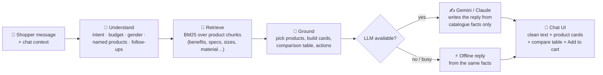
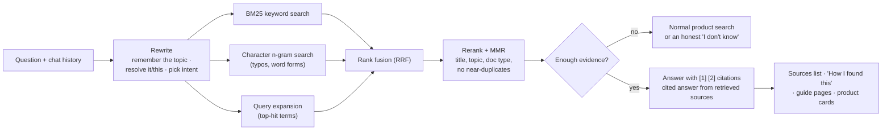

# Architecture and behaviour

Implementation details for the [project](../README.md).

## How it works



1. **Retrieval** (`lib/rag/index.ts`): every product is split into small chunks (overview, each benefit, each spec, technical Q&A, material, sizes, warranty) and scored with **BM25**. It handles synonyms (sneakers → shoes, bike → cycle), typo correction ("shose" → shoes), and ranks products by their best-matching chunk plus a boost when you use words from the product name.
2. **Understanding** (`lib/rag/assistant.ts`): detects categories and sports, budgets, who it's for, superlatives (cheapest, lightest, thickest, best rated, on sale), products named by model ("BR 100", "KS900"), links/IDs, ordinals ("the second one"), comparisons, add-to-cart, store FAQs and items we don't sell.
3. **Generation** (`lib/rag/llm.ts`, `lib/rag/gemini.ts`): the chosen products' full fact sheets plus the best snippets go to the LLM in a `<catalog_context>` block, with a strict "only use these facts" instruction. The rule-based answer is passed along as a factual draft.
4. **Streaming UI** (`app/api/chat/route.ts`, `app/chat/page.tsx`): cards and comparison tables arrive first, then the reply streams in, rendered by a small Markdown formatter (`components/RichText.tsx`) into numbered product rows, bullets and a highlighted "My pick".

### Advanced RAG: knowledge base, hybrid retrieval, citations

Beyond product lookup, the assistant answers **how-to and policy questions** ("how do I choose a badminton racket?", "feather or plastic shuttlecocks?", "what's the return policy?") from a knowledge base, and shows where each answer came from.



- **Knowledge base** (`lib/rag/knowledge.ts`): store policies and buying guides (racket, shuttlecocks, shoes, marathon, yoga mats, backpacks, sizes). Product pages contribute their own written guides too, so retrieval covers about 2,250 passages. Each guide has a page at `/guides/<id>`.
- **Hybrid retrieval** (`lib/rag/hybrid.ts`): BM25 + character n-gram TF-IDF + pseudo-relevance feedback, fused with reciprocal rank fusion, reranked and de-duplicated with MMR. Runs locally without an embedding API.
- **Query rewriting** (`lib/rag/rewrite.ts`): "what about for beginners?" after a badminton question stays on badminton; "is it good for knees?" resolves "it" to the product.
- **Grounded, cited answers** (`lib/rag/answer.ts`): when no LLM is configured, the reply is assembled from the best sentences of the retrieved passages, each tagged with its source number. With Gemini or Claude, the model gets the numbered sources, must answer only from them and cite them; invalid citations are stripped and an uncited answer is replaced by the grounded one.
- **Guardrails**: off-topic questions ("who won the world cup") are declined, weak evidence falls back to normal search instead of guessing, and bare spec lines are never presented as an explanation.
- **Embeddings** are deliberately not required: the retrieval stack needs no API key. A dense-vector retriever could be added as a fourth list in the fusion step.

Measured with `scripts/rag-eval.mjs` on hand-labelled questions: the hybrid pipeline finds the right guide in the top 3 for 97% of 32 tuning questions and 100% of 12 held-out questions (MRR 0.96, against 0.58 on tuning questions and 0.56 on held-out questions for plain BM25). The sets are small, so treat the numbers as a regression guard, not a benchmark.

### What you can ask

| Kind | Examples |
|---|---|
| Needs & use cases | "shoes for marathon with good cushioning", "bikes for mountain", "t shirt for running in summer", "backpack for a 3 day trek" |
| Budgets | "yoga mat below 1k", "under ₹1,500", "1000 se kam", "above 5000", "between 1000 and 3000" |
| Who it's for | "something for my wife who does yoga", "gift for a 10 year old who likes football" (adds a ball-size tip) |
| Superlatives | "cheapest badminton racket", "lightest trekking backpack" (real weights), "thick yoga mat for knees" (sorts by mm), "what's on sale" |
| Specific products | "Kipride Max vs Kipcore Premium", "compare BR 100 and BR Lite 900", "kitna price hai kiprun ks900", a pasted product link |
| Follow-ups | "the second one", "does the first one have pockets?", "is it waterproof?", "which one is lighter?", "show similar products", "what else goes with it?" |
| Actions | "add it to cart" → "Add size 8 to cart" (or tap **Add to cart** on any chat card) |
| Store questions | returns, delivery, store pickup, coupons, payments |
| Out of range | "do you have tennis rackets?" → honest "we don't stock that" + closest alternative; off-topic questions are politely declined |

### Reliability

- **Works with no API key**: the offline assistant answers from the same retrieved facts.
- **Gemini resilience**: low "thinking" for faster replies, a 12-second budget for the first words, a quick retry on "high demand" errors, a backup model, and a 2-minute cooldown where answers come instantly from the catalogue.
- **Regression tests**: `scripts/chat-eval/` holds 36 real shopper conversations (50 turns) that you can re-run after any change.

### Personalised shopping advisor

For yoga pants, yoga mats, trekking backpacks, badminton rackets and running shoes, a request that describes a need ("I'm starting yoga and want pants under ₹1,000", "lightest trekking backpack for a 4 day trek", "compare 2 yoga mats for beginners") starts a guided flow. It runs on the device, so changes are instant and can't race.

- **Pant type first** (`lib/advisor/profiles.ts`): visual cards for fitted leggings, flared, relaxed/straight-fit and capris, read from product names and the listed fit. Length is only an optional refinement. "Help me choose" asks fit and practice, then explains each type from catalogue facts without picking one for you.
- **Activity brief** (`lib/advisor/session.ts`): extracts activity, level, budget and preferences from the message, then asks at most 2 more questions, and only those whose answer would separate the products still in play (Skip / Not sure / No preference). Fit, waist, fabric, pockets, adjustable waistband, feel, everyday use, colour and length sit under **Refine my preferences**. A stated budget is a must-have; everything else is a preference unless you make it a must-have.
- **One source of truth**: chat messages ("make it under 800"), brief edits and "What changes if…?" controls all commit to the same session, with a short "what changed" summary and multi-step **Undo**.
- **Filter → rank → explain** (`lib/advisor/engine.ts`): must-haves decide eligibility (never silently relaxed); eligible products are ranked by your priority and preferences; the deciding reason is recorded. No percentage scores: if the data can't separate two products, it says **"Both are suitable"**.
- **Explanations from facts only** (`lib/advisor/explain.ts`): every sentence is built from the ranking reasons and catalogue fields, with a "View product evidence" panel. Missing data shows as **"Not specified"**, and a control whose data is missing says it "can't be evaluated" instead of faking a change.
- **Only catalogue-backed preferences**: "soft" or "supportive" match only when a product lists that benefit (otherwise "not listed", never a mismatch); missing fit or waist data shows as "Not specified".
- **Activity kit** (`lib/advisor/kit.ts`): mark mat, clothing, blocks and strap as *Already own*, *Need this*, *Not sure* or *Skip*. Owned and skipped items never appear in suggestions or totals; the pants you chose carry over without duplicates; the kit budget is separate from the pants budget; only selected new items with sizes chosen can be added to the cart (items already in it aren't added twice). Blocks and straps aren't in this demo catalogue, so the kit says so instead of inventing products.
- **Profiles per sport** (`lib/advisor/profiles.ts`): each category defines its own criteria, questions and controls (yoga: pant type, fit, waist, fabric, pockets, practice; backpacks: trip duration, capacity, weight). Adding a sport is adding a profile.
- **Saved preferences** are opt-in and stored on this device only (there are no accounts); the budget is never saved.

---

## Configuration

The assistant works without an API key. In `decath-mobile`, copy `.env.example` to `.env.local`, fill in a provider key and restart the server. `.env.local` must stay private.

| Variable | Behaviour |
|---|---|
| `GEMINI_API_KEY` | Enables Gemini when selected. |
| `ANTHROPIC_API_KEY` | Enables Claude when selected. |
| `LLM_PROVIDER` | `gemini`, `claude` or `off`; otherwise uses the first configured key, Claude first. |
| `ASSISTANT_LLM=off` | Also disables LLM generation. |
| `GEMINI_MODELS` | Comma-separated models to try; overrides `GEMINI_MODEL`. |
| `GEMINI_MODEL` | Single-model alternative. |
| `GEMINI_TIMEOUT_MS` | First-output budget across retries; defaults to 12,000 ms. |
| `GEMINI_THINKING` | Thinking level; defaults to `low`. |
| `GEMINI_BASE_URL` | Optional Gemini-compatible endpoint override. |
| `CLAUDE_MODEL` | Claude model override. |

The model names built into the code are configuration defaults, not a guarantee of current provider availability. Use models supported by your account. Gemini includes retries, fallback-model attempts within the time budget and a cooldown after failures. Failed generation falls back to the routed catalogue answer.

## Data and project structure

| Path | Responsibility |
|---|---|
| `decath-mobile/app/` | Store pages, `/d`, `/m`, chat, guides, planner and demo checkout. |
| `decath-mobile/app/api/chat/route.ts` | NDJSON streaming chat API with structured cards, comparisons, actions, sources and text. |
| `decath-mobile/lib/rag/` | Product retrieval, hybrid knowledge retrieval, routing, rewriting, grounded answers and optional providers. |
| `decath-mobile/lib/advisor/` | Profiles, sessions, ranking, explanations and kits. |
| `decath-mobile/lib/plan.ts` | Budget-aware gear purchase timeline. |
| `decath-mobile/lib/store.tsx` | Cart, wishlist, recently viewed and pincode state. |
| `decath-mobile/lib/sizing.ts`, `glossary.ts`, `watch.ts`, `wallet.ts` | Size heuristics, term explanations, local price watches and simulated payments. |
| `decath-mobile/data/products.json` | 87 products in 19 categories. |
| `scripts/build_catalog.py`, `scripts/add_products.py`, `scripts/parse_pdp.py` | Product-page ingestion utilities. |
| `render.yaml` | Render deployment Blueprint. |

Product facts were collected from decathlon.in. Product images load from its CDN; sample review texts and star breakdowns are generated. The data is a snapshot, not a live inventory feed.

To rebuild a catalogue from saved product pages, configure IDs in `scripts/build_catalog.py`, save each page as `<id>.html`, then run from the repository root:

```bash
python3 -I scripts/build_catalog.py <pdp_dir> decath-mobile/data/products.json
```

## Validation

From `decath-mobile`:

```bash
node scripts/rag-eval.mjs
node scripts/advisor-check.mjs
```

Both suites passed during this documentation review. The first checks retrieval against labelled tuning/held-out questions, extractive-answer citations, query memory and guardrails. The second checks advisor journeys, must-haves, missing data, Undo, kit ownership/budgets/sizing, and badminton/marathon support. These deterministic checks do not establish the accuracy of arbitrary live LLM replies.

With the server running, the repository-root conversation runner prints responses for manual inspection:

```bash
python3 scripts/chat-eval/run.py scripts/chat-eval/cases.json
```

This runner is observational, not an assertion-based pass/fail suite, and may call the configured LLM. In this session the browser also verified both store layouts, cited policy answers, the yoga/badminton advisors, kit controls, gear planning and demo checkout. A Gemini failure exercised the offline fallback.

## Operational limits

Catalogue retrieval is local and does not need embeddings. This is a personal prototype without authentication, cross-device state, background jobs, live order management or real payments. Price watches compare the saved target to the bundled catalogue price when viewed; they do not poll a retailer. Shipping estimates and size suggestions are deterministic heuristics. The purchase planner can exceed the budget when even the cheapest selected products do not fit, and surfaces that explicitly.
